<p align="center">
  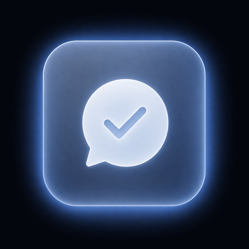
</p>

<h1 align="center">OSG — words every day</h1>

<p align="center">
  Learn German or English with three words a day — in your notifications and on your Home Screen widget.<br/>
  Matched to your level (A1–C1) and your job. Interface in English, Oʻzbekcha and Русский.
</p>

<p align="center">
  <a href="https://osg.kudratov.uz">Website</a> ·
  <a href="https://demo-osg.kudratov.uz"><b>Live dashboard demo</b></a> ·
  <a href="docs/DEVELOPMENT.md">Development guide</a> ·
  <a href="docs/SPEC-v2.md">Spec</a>
</p>

---

<p align="center">
  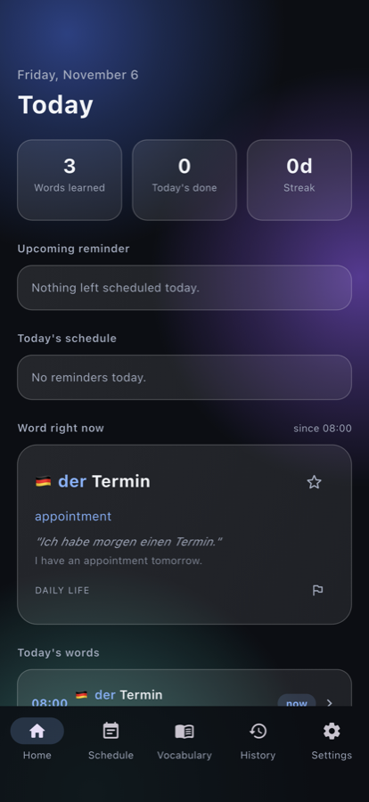
  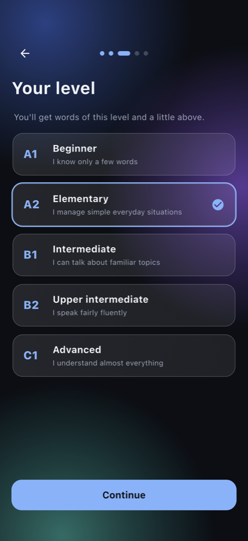
  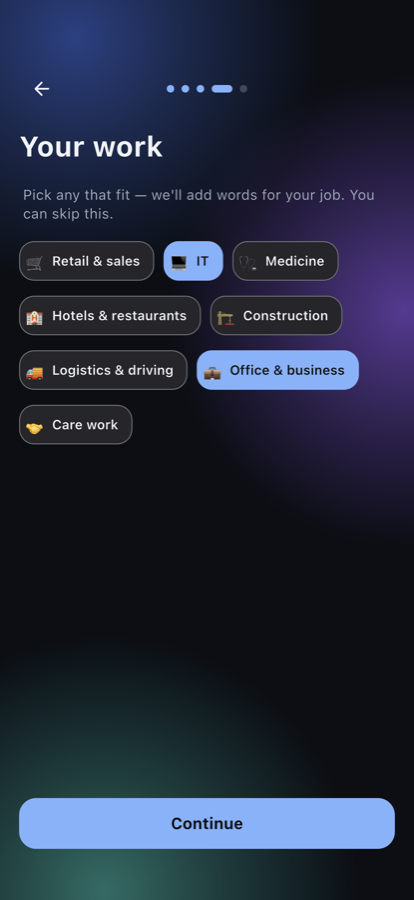
  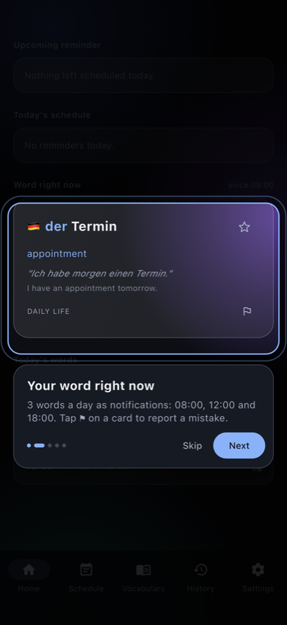
  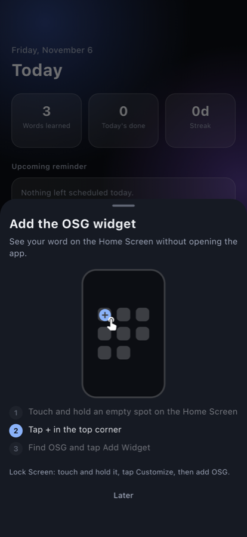
</p>

## What it does

OSG puts one new word in front of you at **08:00, 12:00 and 18:00** — as a notification and on the Home / Lock Screen widget. No lessons to sit through: just three words a day in moments you already spend on your phone.

- **German or English**, about 1,000 words each, every word with an example sentence and its translation
- **Your level (A1–C1):** two words a day at your level and one a little above
- **Words for your job:** retail, IT, medicine, hotels & restaurants, construction, logistics, office, care work
- **Three interface languages:** English, Uzbek, Russian (translations follow the language you speak)
- **German articles in colour** (der / die / das)
- **Own reminders** on the same calm schedule (once, daily, weekdays, weekly, monthly)
- **Plans 7 days ahead**, so words keep coming even if the app isn't opened
- **Report a mistake** on any word; fixes made in the dashboard reach phones within minutes (or on pull-to-refresh)
- **Widgets:** Android Home Screen; iPhone Home Screen (small + wide, Liquid Glass aware) and Lock Screen
- **First-run guide** with coach marks on the real screens
- **No account, no ads.** Works offline once the words are downloaded; anonymous usage stats can be switched off

## Admin dashboard

A small web dashboard manages the word lists and shows how the app is used.

**👉 Try it: [demo-osg.kudratov.uz](https://demo-osg.kudratov.uz)** (sign in with `demo` / `demo`; sample data, read-only).

<p align="center">
  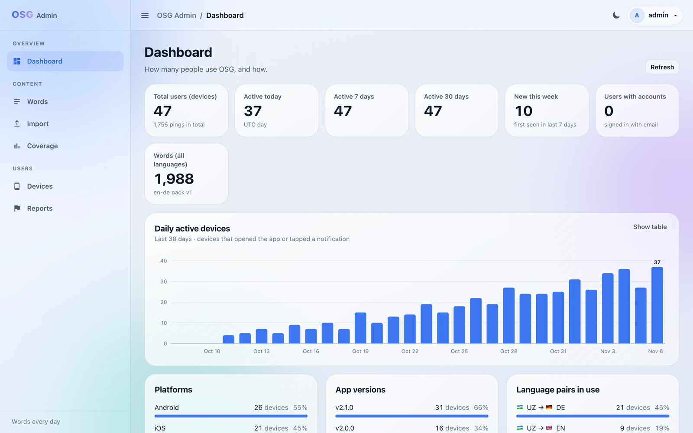
  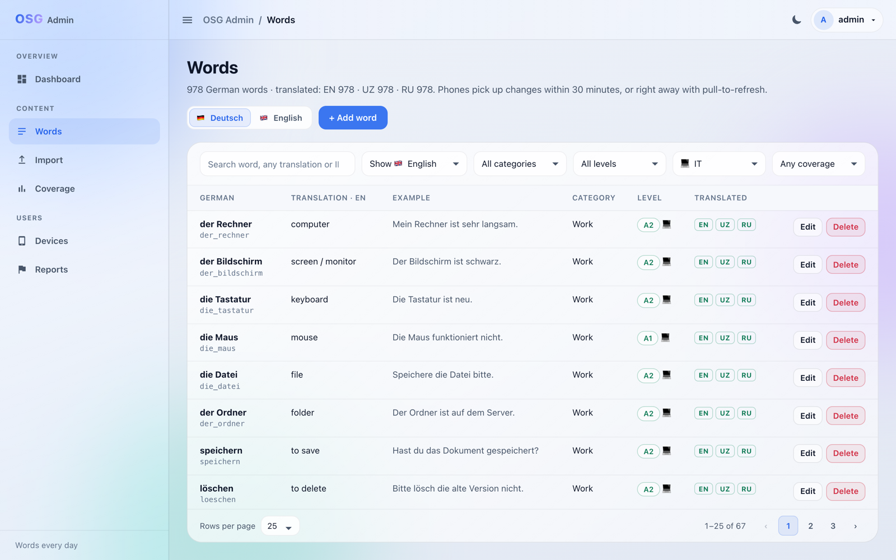
</p>
<p align="center">
  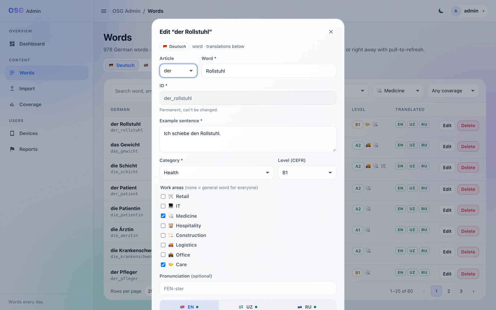
  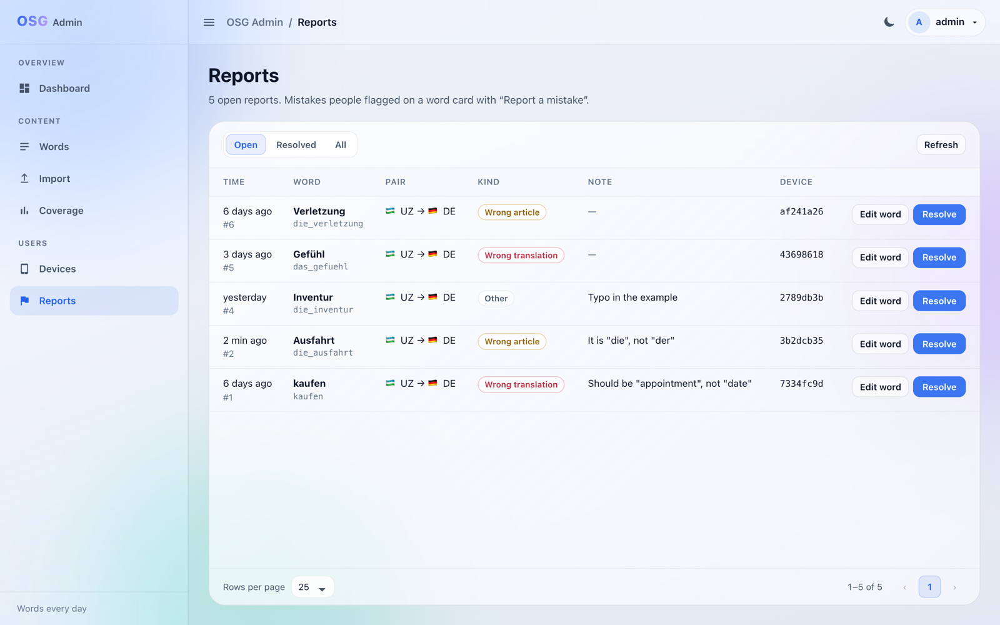
</p>
<p align="center">
  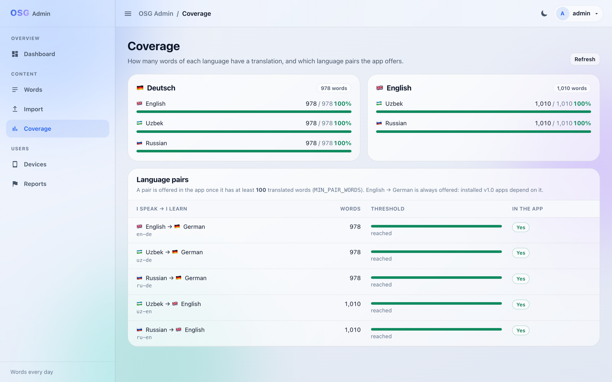
  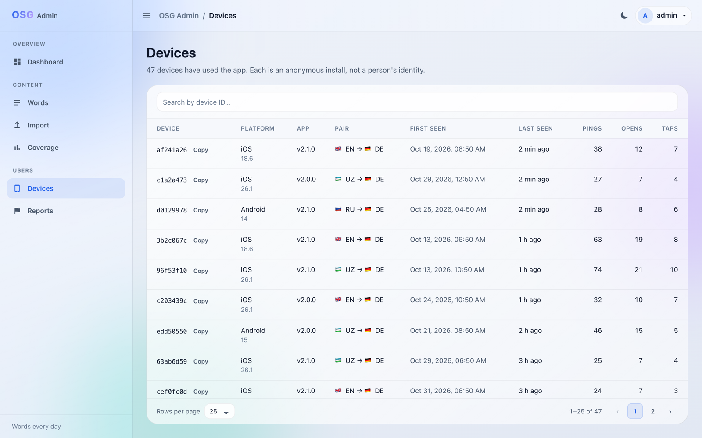
</p>

<sub>Dashboard screenshots use demo data.</sub>

- **Words:** add, edit, delete; CEFR level and work areas; translations per language; filters by level, area, category and missing translations
- **Import:** bulk upsert from JSON with a dry run first
- **Coverage:** which language pairs have enough translated words to be offered in the app
- **Reports:** mistakes users flagged on a word, with a direct "Edit word" link
- **Dashboard / Devices:** anonymous installs, daily activity, platforms, app versions, language pairs

## How it fits together

```
┌──────────────┐  word packs (per language pair)   ┌───────────────────┐      ┌──────────────────┐
│  Flutter app │ ────────────────────────────────▶ │  FastAPI backend  │ ◀─── │  Admin dashboard │
│ Android, iOS │ ◀── anonymous pings, reports ──── │  SQLite/Postgres  │      │  Vue 3 + Vite    │
└──────────────┘                                   └───────────────────┘      └──────────────────┘
   local notifications, widgets,                      content, telemetry,
   offline word bank (Drift/SQLite)                   reports, admin API
```

| Part | Stack | Folder |
|---|---|---|
| App | Flutter / Dart, Drift (SQLite), flutter_local_notifications, home_widget; native widgets in Kotlin and SwiftUI | [`app/`](app) |
| Backend | Python, FastAPI, SQLModel, Alembic | [`backend/`](backend) |
| Dashboard | Vue 3, Vite | [`admin-panel/`](admin-panel) |
| Website | Static HTML/CSS/JS | [`landing/`](landing) |
| Word lists | JSON (general words + 8 work areas), validator | [`backend/content/`](backend/content) |

## Quick start

**Backend**
```bash
cd backend
python3 -m venv .venv && source .venv/bin/activate
pip install -r requirements-dev.txt
ADMIN_API_KEY=dev-key EMAIL_BACKEND=console uvicorn app.main:app --reload
pytest -q
```
On first start it creates the database and loads the word lists from `backend/content/`. To log in to the dashboard, generate a password hash with `python -m app.set_password`.

**App**
```bash
cd app
flutter pub get
flutter run                                                     # offline, bundled English→German words
flutter run --dart-define=API_BASE_URL=http://<your-ip>:8000    # with your local backend
flutter test
```

**Dashboard**
```bash
cd admin-panel
npm install
npm run dev        # http://localhost:5173/panel/ (proxies the API on :8000)
```

**Dashboard demo build** (static, no backend, read-only):
```bash
cd admin-panel
python3 scripts/make-demo-data.py http://127.0.0.1:8000 <ADMIN_API_KEY>   # optional: refresh demo-public/demo-data/ from a backend with demo data
npm run build:demo                                                         # -> dist-demo/, serve as static files
```

More detail (scheduling, widgets, sync, environment variables, endpoints): [docs/DEVELOPMENT.md](docs/DEVELOPMENT.md).

## Word lists

- `backend/content/de.json`, `en.json`: 500 general words per language, with CEFR levels and en/uz/ru translations
- `backend/content/topics/`: words for the 8 work areas, built from simple text files in `topics/src/` with `python3 backend/content/topics/build.py`
- `python3 backend/content/validate.py` checks ids, articles, levels, translations and coverage

Found a wrong word or translation? Open an issue or a pull request against these files.

## Contributing

Issues and pull requests are welcome. Please run the tests for the part you change (`pytest -q` in `backend/`, `flutter test` in `app/`, `npm run build` in `admin-panel/`).

## License

Code: [MIT](LICENSE). The name "OSG", the app icon and the store listings are not covered by the license — if you publish your own build, please use your own name and icon.
